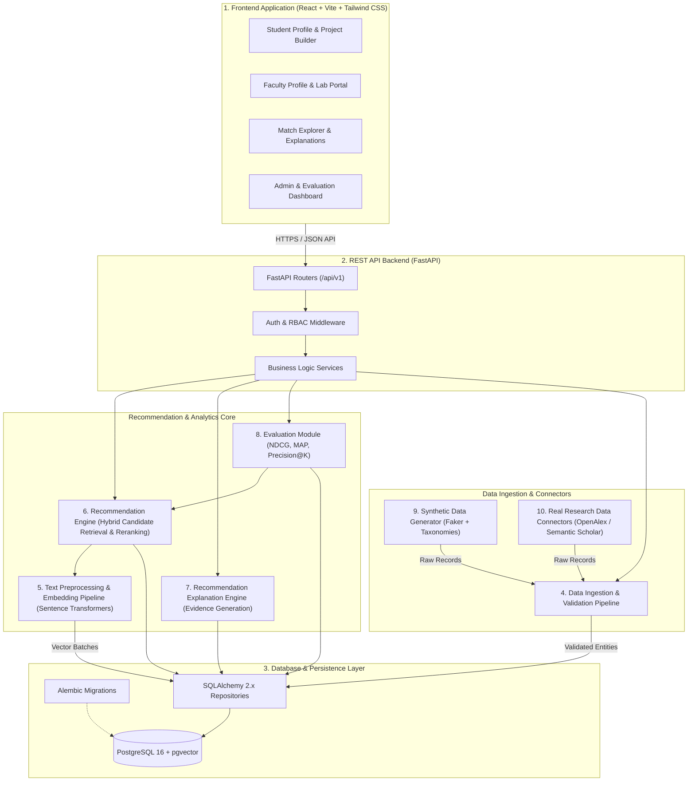

# AI-Powered Researcher–Student Collaboration Recommendation System
## System Architecture & Technical Design Document

**Document Version:** 1.0.0  
**Phase:** Phase 0 (Planning & Architecture)  
**Status:** Approved Architecture Baseline  

---

## 1. Executive Summary & System Vision

The **AI-Powered Researcher–Student Collaboration Recommendation System** is an enterprise-grade academic matchmaking platform. It pairs undergraduate and graduate students with faculty research advisors and project labs based on:
- Latent semantic compatibility between student research statements, academic projects, coursework, and faculty publication abstracts.
- Explicit taxonomic skill alignment (direct skills, methodology matches, research domain hierarchies).
- Structural constraints (faculty mentorship capacity, degree level requirements, departmental affiliations, and project availability).
- Transparent, evidence-based explainability that articulates *why* a faculty member is a strong match, citing specific publications, shared methodologies, and complementary technical strengths.

The system is designed with a **decoupled, modular architecture** that guarantees identical behavior whether populated with synthetic academic datasets (for local testing, prototyping, and privacy-preserving development) or real-world academic data from open bibliometric providers (OpenAlex, Semantic Scholar) and institutional registries.

---

## 2. Technology Stack & Compatibility Matrix

All components have been selected for production stability, active community maintenance, and seamless interoperability.

| Layer | Technology | Version | Rationale & Responsibility |
| :--- | :--- | :--- | :--- |
| **Frontend Framework** | React + TypeScript | React 18.3.x, TS 5.4.x | Type-safe UI architecture, strict rendering control, concurrent features. |
| **Frontend Build Tool** | Vite | 5.3.x | Lightning-fast HMR, optimized ESM bundling, robust development server. |
| **Styling & Design System** | Tailwind CSS + Lucide Icons | Tailwind 3.4.x, Lucide React | Modern aesthetic, utility-first consistency, responsive design, dark/light modes. |
| **Backend Framework** | FastAPI (ASGI) | 0.111.x | Async Python web framework with native OpenAPI doc generation and high throughput. |
| **Validation & Serialization**| Pydantic v2 | 2.7.x | High-performance C-based validation (pydantic-core), strict typing, and schema export. |
| **Database & Vector Store** | PostgreSQL + pgvector | PostgreSQL 16, pgvector 0.7.x | ACID compliance, relational integrity, HNSW indexing for cosine distance searches. |
| **ORM & Migrations** | SQLAlchemy 2.x + Alembic | SQLAlchemy 2.0.30+, Alembic 1.13.x | Modern Core/ORM 2.0 syntax, asyncpg support, reproducible versioned schema migrations. |
| **Data Processing** | Pandas & NumPy | Pandas 2.2.x, NumPy 1.26.x | Ingestion wrangling, batch normalization, tabular feature transformations. |
| **NLP & Machine Learning** | Sentence Transformers, scikit-learn | sentence-transformers 3.0.x, scikit-learn 1.5.x | Dense scientific representation (`all-MiniLM-L6-v2` / `allenai/specter2`), cosine scoring, rank aggregation. |
| **Testing Backend** | pytest, pytest-asyncio, httpx | pytest 8.2.x, pytest-cov 5.0.x | Unit, integration, and API test coverage with async event loop support. |
| **Testing Frontend** | Vitest, React Testing Library | Vitest 1.6.x, RTL 15.x | Unit and component interaction testing in jsdom environment. |
| **Containerization** | Docker & Docker Compose | Docker Compose v2.27+ | Multi-service reproducible development and deployment environment. |

---

## 3. High-Level Modular Architecture

The platform is structured into **10 independent, loosely coupled modules**. Communication between modules is mediated by strict Pydantic schemas, database repository interfaces, or defined service APIs.

---

## 4. Detailed Module Responsibilities & Interfaces

### Module 1: Frontend Application (`frontend/`)
- **Technology**: React 18, TypeScript, Vite, Tailwind CSS, Lucide React, Axios / TanStack Query.
- **Responsibilities**:
  - Intuitive onboarding workflows for students (upload/paste statement of purpose, enter academic projects, select taxonomy-backed skills).
  - Faculty lab profiles detailing research interests, active grants, publication lists, and mentorship capacity toggle.
  - Interactive Match Explorer with real-time filtering (by department, availability, research topic).
  - Transparent Explanation Drawer showing publication snippets, shared skill matrices, and cosine match breakdown.
  - Evaluation & Feedback mechanism: 1-to-5 star rating and feedback submission for active match quality.

### Module 2: REST API Backend (`backend/app/api/`)
- **Technology**: FastAPI, Pydantic v2, Starlette, Uvicorn.
- **Responsibilities**:
  - Expose standardized RESTful endpoints under `/api/v1/`.
  - JWT-based authentication and role-based access control (Student, Faculty, Admin).
  - Validation of incoming payloads with RFC 7807 compliant structured error responses.
  - Request throttling, CORS management, and health/readiness endpoints.

### Module 3: Database & Data-Access Layer (`backend/app/db/` & `backend/app/repositories/`)
- **Technology**: PostgreSQL 16 with `pgvector`, SQLAlchemy 2.0 (Async Session), Alembic.
- **Responsibilities**:
  - Declarative definition of all normalized relational tables and vector columns.
  - Repository pattern isolating SQL queries, joins, and transactions from business logic.
  - HNSW vector index maintenance for sub-millisecond approximate nearest neighbor searches.
  - Transaction safety, cascading rules, and connection pool management.

### Module 4: Data Ingestion & Validation (`backend/app/ingestion/`)
- **Technology**: Pydantic v2, Python `dataclasses`, Pandas.
- **Responsibilities**:
  - Schema normalization of inbound entities regardless of origin (synthetic generator, CSV import, or live API).
  - Deduplication engine: Entity resolution for publications via normalized DOI, PMID, or ArXiv ID with title string hashing fallback.
  - Batch insertion and upsert logic with atomic transaction boundaries.
  - Ingestion audit trail: writing records into `import_jobs` and `entity_provenance`.

### Module 5: Text Preprocessing & Embedding Generation (`backend/app/embeddings/`)
- **Technology**: Sentence Transformers (`sentence-transformers/all-MiniLM-L6-v2` or domain-specific `allenai/specter2`), PyTorch, NumPy.
- **Responsibilities**:
  - Profile text compilation: Combining student statement of purpose, project descriptions, and course interests into structured textual representations.
  - Publication text compilation: Combining paper title, abstract, and venue keywords.
  - Embedding generation with batching and GPU/CPU device auto-detection.
  - Vector caching and conditional re-computation (only when source text hash changes).

### Module 6: Recommendation Engine (`backend/app/recommendations/`)
- **Technology**: NumPy, scikit-learn, pgvector SQL queries.
- **Responsibilities**:
  - **Stage 1 (Candidate Retrieval)**: pgvector cosine similarity lookup querying student profile embedding against faculty holistic embeddings and individual publication embeddings, filtering out ineligible faculty (zero capacity, wrong department constraints if requested).
  - **Stage 2 (Multi-Dimensional Feature Extraction)**:
    1. *Semantic Similarity Score* ($S_{\text{semantic}}$): Weighted maximum and mean cosine similarities between student profile and faculty publications.
    2. *Taxonomic Skill Overlap Score* ($S_{\text{skill}}$): Jaccard index and weighted taxonomy depth score between student verified skills and faculty expertise.
    3. *Project Experience Score* ($S_{\text{project}}$): Cosine similarity between student past projects and faculty ongoing research keywords.
    4. *Capacity & Availability Factor* ($F_{\text{capacity}}$): Soft weight penalizing overloaded labs while boosting labs actively seeking students.
  - **Stage 3 (Scoring & Re-ranking)**:
    $$\text{Final Score} = w_1 S_{\text{semantic}} + w_2 S_{\text{skill}} + w_3 S_{\text{project}} + w_4 F_{\text{capacity}}$$
  - Execution tracking: Storing run parameters and generated ranking in `recommendation_runs` and `recommendation_results`.

### Module 7: Recommendation Explanation Engine (`backend/app/explanations/`)
- **Technology**: Python NLP heuristics, JSON templating.
- **Responsibilities**:
  - Compute contribution breakdown for each top-ranked faculty match.
  - Identify the top $K$ most relevant publications authored by the faculty member that drive the semantic score.
  - Extract exact matching skills and related taxonomy concepts (e.g., student knows "PyTorch", faculty works in "Deep Learning").
  - Synthesize an evidence summary in structured JSON format for client rendering (visual badges, highlighted paper snippets, and score decomposition bars).

### Module 8: Evaluation Module (`backend/app/evaluation/`)
- **Technology**: scikit-learn, Pandas, NumPy.
- **Responsibilities**:
  - Maintain benchmark relevance datasets (`relevance_judgments`) containing student-faculty pairs graded on a 0–3 relevance scale (0 = Irrelevant, 1 = Weak, 2 = Strong, 3 = Perfect match).
  - Compute ranking metrics:
    - **NDCG@K** (Normalized Discounted Cumulative Gain at $K=5, 10$).
    - **Precision@K** and **Recall@K**.
    - **MAP** (Mean Average Precision).
    - **MRR** (Mean Reciprocal Rank).
  - Provide regression test assertions: Ensure algorithm updates or embedding model changes do not degrade baseline benchmark scores.

### Module 9: Synthetic Data Generator (`backend/app/synthetic/`)
- **Technology**: Faker, NumPy, Python standard library.
- **Responsibilities**:
  - Generate realistic university topologies: Departments, research labs, faculty members, and students.
  - Generate hierarchical research taxonomy (e.g., Computer Science -> Artificial Intelligence -> Reinforcement Learning).
  - Create coherent synthetic publications with domain-appropriate titles, abstracts, and simulated publication histories.
  - Create student profiles with correlated skills, project narratives, and statements of purpose.
  - Output standardized schemas compatible with Module 4 (Ingestion Pipeline).

### Module 10: Real Research Data Connectors (`backend/app/connectors/`)
- **Technology**: `httpx` (async HTTP), tenacity (retry logic), Pydantic.
- **Responsibilities**:
  - **OpenAlex Connector**: Search researchers by ROR (Research Organization Registry) or university affiliation, retrieve works, concepts, and author metrics.
  - **Semantic Scholar Connector**: Fetch author citation profiles, paper abstracts, and co-authorship networks.
  - Rate limiting, API key rotation, pagination, and backoff handling.
  - Transform external JSON payloads into normalized Ingestion DTOs.

---

## 5. Security & Authentication Architecture

1. **Authentication Flow**:
   - OAuth2 with Password Flow (issuing signed HS256/RS256 JWT access and refresh tokens).
   - Passwords hashed using `bcrypt` (or `argon2id`) with minimum salt cost 12.
2. **Authorization & RBAC**:
   - Roles: `STUDENT`, `FACULTY`, `ADMIN`.
   - Role-enforcing FastAPI dependencies (`require_role("FACULTY")`, `get_current_active_user`).
   - Ownership verification: Students can only modify their own profiles; Faculty can only update their own lab availability.
3. **Data Protection & Sanitization**:
   - Parameterized queries enforced via SQLAlchemy ORM (SQL injection prevention).
   - Strict Pydantic input validation and HTML stripping on text fields (XSS prevention).
   - CORS policy explicitly configured for authorized frontend origins.
   - Vector operations executed natively within PostgreSQL through parameterized pgvector operators (`<=>`, `<#>`).

---

## 6. Scalability & Performance Strategy

1. **Database & Vector Search**:
   - HNSW (`vector_cosine_ops`) indexing on embeddings tables with `m=16` and `ef_construction=64`, providing sub-5ms retrieval for 100,000+ vectors.
   - Connection pooling with `asyncpg` (min 10, max 30 connections per worker).
2. **Caching Strategy**:
   - In-memory or Redis-ready caching for static taxonomy trees and faculty profile embeddings.
   - SHA-256 content hashing on student and publication text to bypass redundant embedding inferences.
3. **Batch Processing**:
   - Vectorization is decoupled from API request threads; bulk imports vectorize texts in minibatches of 32 or 64.
