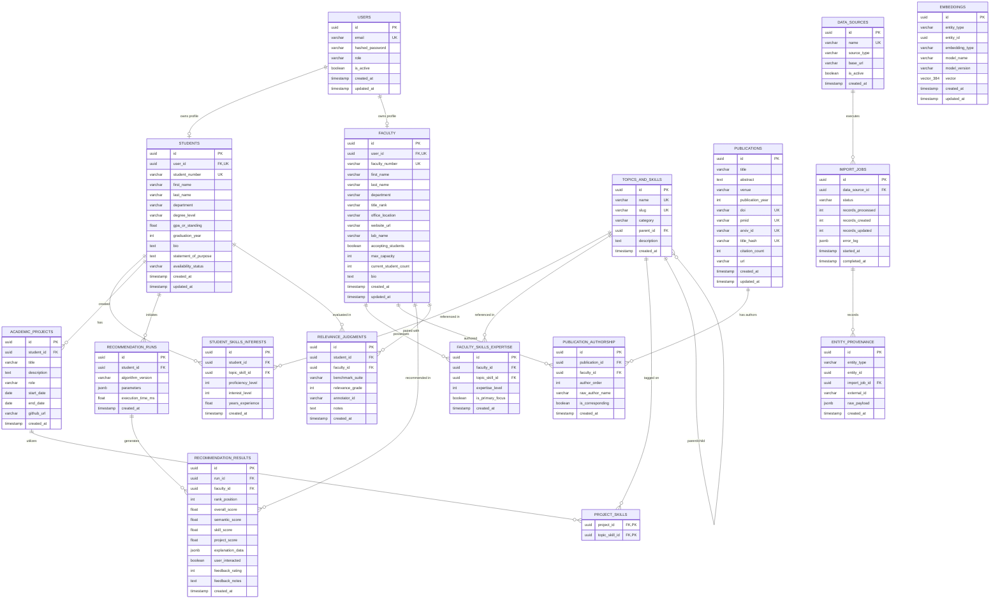

# Database Schema & Entity-Relationship Specification

**Document Version:** 1.0.0  
**Phase:** Phase 0 (Planning & Architecture)  
**Database Engine:** PostgreSQL 16 with `pgvector` extension  
**ORM:** SQLAlchemy 2.0+ (Declarative Mapping)  
**Migration Tool:** Alembic  

---

## 1. Entity-Relationship Diagram (ERD)



---

## 2. Table Schemas, Constraints & Data Types

### 2.1 Identity and User Access (`users`)
Authenticates system users and manages role-based access.
```sql
CREATE TABLE users (
    id UUID PRIMARY KEY DEFAULT gen_random_uuid(),
    email VARCHAR(255) NOT NULL UNIQUE,
    hashed_password VARCHAR(255) NOT NULL,
    role VARCHAR(50) NOT NULL CHECK (role IN ('STUDENT', 'FACULTY', 'ADMIN')),
    is_active BOOLEAN NOT NULL DEFAULT TRUE,
    created_at TIMESTAMPTZ NOT NULL DEFAULT CURRENT_TIMESTAMP,
    updated_at TIMESTAMPTZ NOT NULL DEFAULT CURRENT_TIMESTAMP
);
CREATE INDEX idx_users_email ON users(email);
CREATE INDEX idx_users_role ON users(role);
```

### 2.2 Student Profiles (`students`)
Stores academic profiles, degree progress, and research statements.
```sql
CREATE TABLE students (
    id UUID PRIMARY KEY DEFAULT gen_random_uuid(),
    user_id UUID NOT NULL UNIQUE REFERENCES users(id) ON DELETE CASCADE,
    student_number VARCHAR(64) UNIQUE,
    first_name VARCHAR(100) NOT NULL,
    last_name VARCHAR(100) NOT NULL,
    department VARCHAR(150) NOT NULL,
    degree_level VARCHAR(50) NOT NULL CHECK (degree_level IN ('UNDERGRADUATE', 'MASTERS', 'PHD')),
    gpa_or_standing NUMERIC(3, 2),
    graduation_year INT,
    bio TEXT,
    statement_of_purpose TEXT NOT NULL,
    availability_status VARCHAR(50) NOT NULL DEFAULT 'SEEKING_ADVISOR' 
        CHECK (availability_status IN ('SEEKING_ADVISOR', 'OPEN_TO_PROJECTS', 'NOT_AVAILABLE')),
    created_at TIMESTAMPTZ NOT NULL DEFAULT CURRENT_TIMESTAMP,
    updated_at TIMESTAMPTZ NOT NULL DEFAULT CURRENT_TIMESTAMP
);
CREATE INDEX idx_students_dept ON students(department);
CREATE INDEX idx_students_degree ON students(degree_level);
CREATE INDEX idx_students_availability ON students(availability_status);
```

### 2.3 Faculty Profiles (`faculty`)
Stores faculty research leadership, department, office, and mentorship capacity.
```sql
CREATE TABLE faculty (
    id UUID PRIMARY KEY DEFAULT gen_random_uuid(),
    user_id UUID NOT NULL UNIQUE REFERENCES users(id) ON DELETE CASCADE,
    faculty_number VARCHAR(64) UNIQUE,
    first_name VARCHAR(100) NOT NULL,
    last_name VARCHAR(100) NOT NULL,
    department VARCHAR(150) NOT NULL,
    title_rank VARCHAR(100) NOT NULL CHECK (title_rank IN ('ASSISTANT_PROFESSOR', 'ASSOCIATE_PROFESSOR', 'FULL_PROFESSOR', 'RESEARCH_SCIENTIST', 'EMERITUS')),
    office_location VARCHAR(150),
    website_url VARCHAR(512),
    lab_name VARCHAR(255),
    accepting_students BOOLEAN NOT NULL DEFAULT TRUE,
    max_capacity INT NOT NULL DEFAULT 5 CHECK (max_capacity >= 0),
    current_student_count INT NOT NULL DEFAULT 0 CHECK (current_student_count >= 0),
    bio TEXT,
    created_at TIMESTAMPTZ NOT NULL DEFAULT CURRENT_TIMESTAMP,
    updated_at TIMESTAMPTZ NOT NULL DEFAULT CURRENT_TIMESTAMP
);
CREATE INDEX idx_faculty_dept ON faculty(department);
CREATE INDEX idx_faculty_accepting ON faculty(accepting_students);
```

### 2.4 Taxonomy: Skills and Research Topics (`topics_and_skills`)
A normalized, self-referential taxonomy supporting hierarchical research disciplines, methodologies, and technical skills.
```sql
CREATE TABLE topics_and_skills (
    id UUID PRIMARY KEY DEFAULT gen_random_uuid(),
    name VARCHAR(150) NOT NULL UNIQUE,
    slug VARCHAR(150) NOT NULL UNIQUE,
    category VARCHAR(50) NOT NULL CHECK (category IN ('RESEARCH_TOPIC', 'METHODOLOGY', 'TECHNICAL_SKILL', 'DOMAIN')),
    parent_id UUID REFERENCES topics_and_skills(id) ON DELETE SET NULL,
    description TEXT,
    created_at TIMESTAMPTZ NOT NULL DEFAULT CURRENT_TIMESTAMP
);
CREATE INDEX idx_topics_parent ON topics_and_skills(parent_id);
CREATE INDEX idx_topics_category ON topics_and_skills(category);
```

### 2.5 Student Skill & Interest Associations (`student_skills_interests`)
```sql
CREATE TABLE student_skills_interests (
    id UUID PRIMARY KEY DEFAULT gen_random_uuid(),
    student_id UUID NOT NULL REFERENCES students(id) ON DELETE CASCADE,
    topic_skill_id UUID NOT NULL REFERENCES topics_and_skills(id) ON DELETE CASCADE,
    proficiency_level INT NOT NULL DEFAULT 3 CHECK (proficiency_level BETWEEN 1 AND 5),
    interest_level INT NOT NULL DEFAULT 5 CHECK (interest_level BETWEEN 1 AND 5),
    years_experience NUMERIC(4, 1) DEFAULT 1.0,
    created_at TIMESTAMPTZ NOT NULL DEFAULT CURRENT_TIMESTAMP,
    CONSTRAINT uq_student_skill UNIQUE (student_id, topic_skill_id)
);
CREATE INDEX idx_student_skills_student ON student_skills_interests(student_id);
CREATE INDEX idx_student_skills_topic ON student_skills_interests(topic_skill_id);
```

### 2.6 Faculty Skills & Expertise Associations (`faculty_skills_expertise`)
```sql
CREATE TABLE faculty_skills_expertise (
    id UUID PRIMARY KEY DEFAULT gen_random_uuid(),
    faculty_id UUID NOT NULL REFERENCES faculty(id) ON DELETE CASCADE,
    topic_skill_id UUID NOT NULL REFERENCES topics_and_skills(id) ON DELETE CASCADE,
    expertise_level INT NOT NULL DEFAULT 5 CHECK (expertise_level BETWEEN 1 AND 5),
    is_primary_focus BOOLEAN NOT NULL DEFAULT FALSE,
    created_at TIMESTAMPTZ NOT NULL DEFAULT CURRENT_TIMESTAMP,
    CONSTRAINT uq_faculty_skill UNIQUE (faculty_id, topic_skill_id)
);
CREATE INDEX idx_faculty_skills_faculty ON faculty_skills_expertise(faculty_id);
CREATE INDEX idx_faculty_skills_topic ON faculty_skills_expertise(topic_skill_id);
```

### 2.7 Academic Projects (`academic_projects` & `project_skills`)
Tracks student capstone projects, past research work, or open source contributions.
```sql
CREATE TABLE academic_projects (
    id UUID PRIMARY KEY DEFAULT gen_random_uuid(),
    student_id UUID NOT NULL REFERENCES students(id) ON DELETE CASCADE,
    title VARCHAR(255) NOT NULL,
    description TEXT NOT NULL,
    role VARCHAR(100),
    start_date DATE,
    end_date DATE,
    github_url VARCHAR(512),
    created_at TIMESTAMPTZ NOT NULL DEFAULT CURRENT_TIMESTAMP
);
CREATE INDEX idx_academic_projects_student ON academic_projects(student_id);

CREATE TABLE project_skills (
    project_id UUID NOT NULL REFERENCES academic_projects(id) ON DELETE CASCADE,
    topic_skill_id UUID NOT NULL REFERENCES topics_and_skills(id) ON DELETE CASCADE,
    PRIMARY KEY (project_id, topic_skill_id)
);
```

### 2.8 Normalized Publications (`publications` & `publication_authorship`)
Normalized store for papers, avoiding duplication when faculty co-author publications. Deduplicated by DOI, PMID, ArXiv ID, or normalized title hash.
```sql
CREATE TABLE publications (
    id UUID PRIMARY KEY DEFAULT gen_random_uuid(),
    title VARCHAR(512) NOT NULL,
    abstract TEXT NOT NULL,
    venue VARCHAR(255),
    publication_year INT CHECK (publication_year BETWEEN 1900 AND 2100),
    doi VARCHAR(128) UNIQUE,
    pmid VARCHAR(64) UNIQUE,
    arxiv_id VARCHAR(64) UNIQUE,
    title_hash VARCHAR(64) NOT NULL UNIQUE,
    citation_count INT NOT NULL DEFAULT 0,
    url VARCHAR(512),
    created_at TIMESTAMPTZ NOT NULL DEFAULT CURRENT_TIMESTAMP,
    updated_at TIMESTAMPTZ NOT NULL DEFAULT CURRENT_TIMESTAMP
);
CREATE INDEX idx_publications_year ON publications(publication_year);
CREATE INDEX idx_publications_title_hash ON publications(title_hash);
CREATE INDEX idx_publications_doi ON publications(doi);

CREATE TABLE publication_authorship (
    id UUID PRIMARY KEY DEFAULT gen_random_uuid(),
    publication_id UUID NOT NULL REFERENCES publications(id) ON DELETE CASCADE,
    faculty_id UUID REFERENCES faculty(id) ON DELETE SET NULL,
    author_order INT NOT NULL DEFAULT 1,
    raw_author_name VARCHAR(150) NOT NULL,
    is_corresponding BOOLEAN NOT NULL DEFAULT FALSE,
    created_at TIMESTAMPTZ NOT NULL DEFAULT CURRENT_TIMESTAMP,
    CONSTRAINT uq_publication_faculty UNIQUE (publication_id, faculty_id)
);
CREATE INDEX idx_authorship_publication ON publication_authorship(publication_id);
CREATE INDEX idx_authorship_faculty ON publication_authorship(faculty_id);
```

### 2.9 Unified Vector Embeddings (`embeddings`)
Leverages `pgvector` with 384 dimensions (`all-MiniLM-L6-v2` / `bge-small-en`).
```sql
CREATE EXTENSION IF NOT EXISTS vector;

CREATE TABLE embeddings (
    id UUID PRIMARY KEY DEFAULT gen_random_uuid(),
    entity_type VARCHAR(50) NOT NULL CHECK (entity_type IN ('STUDENT', 'FACULTY', 'PUBLICATION', 'PROJECT')),
    entity_id UUID NOT NULL,
    embedding_type VARCHAR(50) NOT NULL CHECK (embedding_type IN ('HOLISTIC_PROFILE', 'ABSTRACT', 'SKILLS_TEXT', 'STATEMENT')),
    model_name VARCHAR(100) NOT NULL,
    model_version VARCHAR(50) NOT NULL,
    vector vector(384) NOT NULL,
    created_at TIMESTAMPTZ NOT NULL DEFAULT CURRENT_TIMESTAMP,
    updated_at TIMESTAMPTZ NOT NULL DEFAULT CURRENT_TIMESTAMP,
    CONSTRAINT uq_entity_embedding UNIQUE (entity_type, entity_id, embedding_type, model_version)
);
CREATE INDEX idx_embeddings_entity ON embeddings(entity_type, entity_id);

-- HNSW Index for rapid approximate nearest neighbor search via cosine distance
CREATE INDEX idx_embeddings_vector_hnsw ON embeddings 
USING hnsw (vector vector_cosine_ops)
WITH (m = 16, ef_construction = 64);
```

### 2.10 Recommendation Runs & Results (`recommendation_runs` & `recommendation_results`)
Maintains recommendation audit history and evidence explanation payloads.
```sql
CREATE TABLE recommendation_runs (
    id UUID PRIMARY KEY DEFAULT gen_random_uuid(),
    student_id UUID NOT NULL REFERENCES students(id) ON DELETE CASCADE,
    algorithm_version VARCHAR(50) NOT NULL,
    parameters JSONB NOT NULL DEFAULT '{}'::jsonb,
    execution_time_ms NUMERIC(8, 2) NOT NULL,
    created_at TIMESTAMPTZ NOT NULL DEFAULT CURRENT_TIMESTAMP
);
CREATE INDEX idx_rec_runs_student ON recommendation_runs(student_id);
CREATE INDEX idx_rec_runs_created ON recommendation_runs(created_at);

CREATE TABLE recommendation_results (
    id UUID PRIMARY KEY DEFAULT gen_random_uuid(),
    run_id UUID NOT NULL REFERENCES recommendation_runs(id) ON DELETE CASCADE,
    faculty_id UUID NOT NULL REFERENCES faculty(id) ON DELETE CASCADE,
    rank_position INT NOT NULL CHECK (rank_position > 0),
    overall_score NUMERIC(5, 4) NOT NULL,
    semantic_score NUMERIC(5, 4) NOT NULL,
    skill_score NUMERIC(5, 4) NOT NULL,
    project_score NUMERIC(5, 4) NOT NULL,
    explanation_data JSONB NOT NULL DEFAULT '{}'::jsonb,
    user_interacted BOOLEAN NOT NULL DEFAULT FALSE,
    feedback_rating INT CHECK (feedback_rating BETWEEN 1 AND 5),
    feedback_notes TEXT,
    created_at TIMESTAMPTZ NOT NULL DEFAULT CURRENT_TIMESTAMP,
    CONSTRAINT uq_run_faculty UNIQUE (run_id, faculty_id)
);
CREATE INDEX idx_rec_results_run ON recommendation_results(run_id);
CREATE INDEX idx_rec_results_faculty ON recommendation_results(faculty_id);
```

### 2.11 Evaluation Relevance Judgments (`relevance_judgments`)
Benchmark ground-truth dataset used by Module 8 to compute NDCG@K, Precision@K, and MAP.
```sql
CREATE TABLE relevance_judgments (
    id UUID PRIMARY KEY DEFAULT gen_random_uuid(),
    student_id UUID NOT NULL REFERENCES students(id) ON DELETE CASCADE,
    faculty_id UUID NOT NULL REFERENCES faculty(id) ON DELETE CASCADE,
    benchmark_suite VARCHAR(100) NOT NULL DEFAULT 'standard_eval_v1',
    relevance_grade INT NOT NULL CHECK (relevance_grade BETWEEN 0 AND 3), -- 0=Irrelevant, 1=Marginal, 2=Relevant, 3=Highly Relevant
    annotator_id VARCHAR(100) NOT NULL,
    notes TEXT,
    created_at TIMESTAMPTZ NOT NULL DEFAULT CURRENT_TIMESTAMP,
    CONSTRAINT uq_student_faculty_suite UNIQUE (student_id, faculty_id, benchmark_suite)
);
CREATE INDEX idx_rel_judgments_suite ON relevance_judgments(benchmark_suite);
```

### 2.12 Provenance & Import Tracking (`data_sources`, `import_jobs`, `entity_provenance`)
Tracks origins of both synthetic runs and external academic API harvests.
```sql
CREATE TABLE data_sources (
    id UUID PRIMARY KEY DEFAULT gen_random_uuid(),
    name VARCHAR(100) NOT NULL UNIQUE,
    source_type VARCHAR(50) NOT NULL CHECK (source_type IN ('SYNTHETIC', 'OPENALEX', 'SEMANTIC_SCHOLAR', 'INSTITUTIONAL_CSV', 'MANUAL')),
    base_url VARCHAR(512),
    is_active BOOLEAN NOT NULL DEFAULT TRUE,
    created_at TIMESTAMPTZ NOT NULL DEFAULT CURRENT_TIMESTAMP
);

CREATE TABLE import_jobs (
    id UUID PRIMARY KEY DEFAULT gen_random_uuid(),
    data_source_id UUID NOT NULL REFERENCES data_sources(id) ON DELETE CASCADE,
    status VARCHAR(50) NOT NULL DEFAULT 'PENDING' CHECK (status IN ('PENDING', 'RUNNING', 'COMPLETED', 'FAILED')),
    records_processed INT NOT NULL DEFAULT 0,
    records_created INT NOT NULL DEFAULT 0,
    records_updated INT NOT NULL DEFAULT 0,
    error_log JSONB NOT NULL DEFAULT '[]'::jsonb,
    started_at TIMESTAMPTZ,
    completed_at TIMESTAMPTZ
);
CREATE INDEX idx_import_jobs_source ON import_jobs(data_source_id);

CREATE TABLE entity_provenance (
    id UUID PRIMARY KEY DEFAULT gen_random_uuid(),
    entity_type VARCHAR(50) NOT NULL CHECK (entity_type IN ('STUDENT', 'FACULTY', 'PUBLICATION', 'TOPIC')),
    entity_id UUID NOT NULL,
    import_job_id UUID NOT NULL REFERENCES import_jobs(id) ON DELETE CASCADE,
    external_id VARCHAR(255),
    raw_payload JSONB,
    created_at TIMESTAMPTZ NOT NULL DEFAULT CURRENT_TIMESTAMP,
    CONSTRAINT uq_entity_provenance UNIQUE (entity_type, entity_id, import_job_id)
);
CREATE INDEX idx_entity_provenance_ext ON entity_provenance(entity_type, external_id);
```
