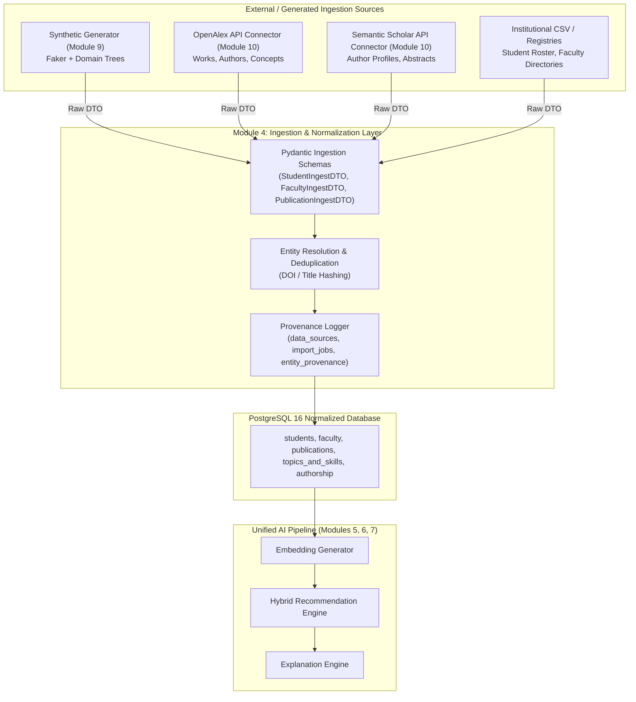

# Data Harmonization Strategy: Synthetic to Real Research Data

**Document Version:** 1.0.0  
**Phase:** Phase 0 (Planning & Architecture)  

---

## 1. Unified Schema Paradigm

A core architectural requirement of the *AI-Powered Researcher–Student Collaboration Recommendation System* is that **the recommendation pipeline, vector embeddings, and explanation engines remain completely agnostic to whether data was synthetically generated or harvested from real academic registries.**

To achieve this, all external data flows through a **Normalized Ingestion Layer** (Module 4) that maps raw heterogeneous structures into standardized internal schemas:



---

## 2. Ingestion Data Transfer Objects (DTOs)

Regardless of data source, records are converted into uniform Pydantic models before touching the database repository:

```python
class PublicationIngestDTO(BaseModel):
    title: str
    abstract: str
    venue: Optional[str] = None
    publication_year: Optional[int] = None
    doi: Optional[str] = None
    pmid: Optional[str] = None
    arxiv_id: Optional[str] = None
    citation_count: int = 0
    url: Optional[str] = None
    authors: List[str]  # Raw author strings for resolution
    source_name: str    # e.g., "synthetic_generator", "openalex", "semantic_scholar"
    source_record_id: str
```

---

## 3. Provenance & Entity Resolution Strategy

### 3.1 Deduplication of Co-Authored Publications
Real-world faculty frequently co-author papers with colleagues in the same institution. If Faculty A and Faculty B both have a publication on OpenAlex, the system must not create two publication records.
1. **Primary Key Match**: If `doi` is present, look up existing publication by normalized DOI (`lower(doi).strip()`).
2. **Secondary Match**: If no DOI, compute `title_hash = sha256(normalize(title) + str(publication_year))`.
3. **Authorship Linkage**: If the publication already exists in the `publications` table, link the faculty member in `publication_authorship` with their `author_order`. No duplicate text or vector embedding is stored.

### 3.2 Provenance Tracking
Every ingested record is tracked in `entity_provenance`:
- Links the internal entity (`STUDENT`, `FACULTY`, `PUBLICATION`) to the `import_job_id` and the external upstream identifier (e.g. OpenAlex Work ID `W3128491823` or Semantic Scholar Paper ID `649def342...`).
- Stores raw source payloads in `raw_payload` (JSONB) for auditability and diagnostic re-parsing.

---

## 4. Phased Transition Strategy: From Synthetic to Real Data

### Phase 2 (Synthetic Baseline)
- Seed 50 students, 20 faculty members, and 200 publications using Faker and predefined scientific taxonomies.
- Enables immediate, full-lifecycle development of vector pipelines, recommendation algorithms, and UI components without API rate-limit barriers or privacy issues.

### Phase 7 (Real Data Connectors Integration)
- Connectors for OpenAlex and Semantic Scholar harvest verified publication lists for designated faculty members.
- The Ingestion Pipeline resolves real publications against synthetic ones.
- **Side-by-side Operation**: Synthetic faculty and real faculty can coexist in the same database, differentiated only by their `data_source_id`.

### Production Deployment (Institutional Onboarding)
- Real student data ingested securely via CSV / Institutional SIS export (Student Information System).
- Real faculty publication records updated on a scheduled weekly cron via the OpenAlex API connector.
- **Zero Recommender Redesign**: The recommendation engine queries `faculty`, `publications`, and `embeddings` through the exact same SQLAlchemy query interfaces.
