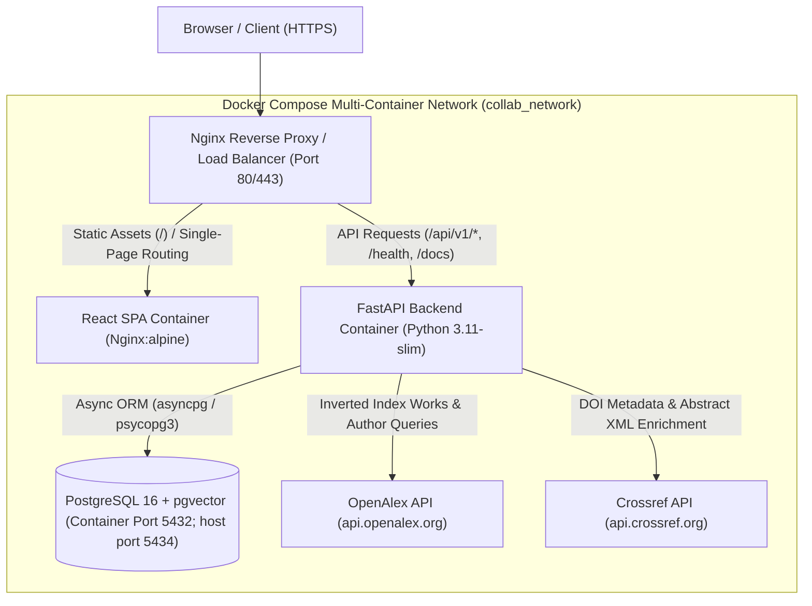

# Deployment & Operations Manual: AI-Powered Researcher–Student Collaboration System

This document outlines the deployment topology, environment configuration, database migration and backup procedures, and operational health checks for deploying the AI-Powered Researcher–Student Collaboration Recommendation System to production.

---

## 1. Production Architecture Overview



---

## 2. Docker Compose Production Deployment

The root directory provides `docker-compose.yml` defining three coordinated services:

| Service | Container Name | Base Image | Role |
| :--- | :--- | :--- | :--- |
| **`db`** | `stu_postgres` | `pgvector/pgvector:pg16` | Relational storage & 384-d vector embeddings |
| **`backend`** | `stu_backend` | `python:3.11-slim` | FastAPI REST API, recommendation engine, ML embeddings |
| **`frontend`** | `stu_frontend` | `node:20-alpine` + `nginx:alpine` | Static Vite bundle with SPA routing & reverse proxy |

### Starting the Stack
```bash
# 1. Clone repository and navigate to root
git clone <repo-url> /opt/stu
cd /opt/stu

# 2. Configure production environment variables
cp .env.example .env
nano .env  # set secure passwords, SECRET_KEY, and polite mailto

# 3. Build and launch containers in daemon mode
docker compose up -d --build

# 4. Inspect container health status
docker compose ps
```

The backend container automatically runs `alembic upgrade head` on startup before launching Uvicorn with the Gunicorn/Uvicorn process manager.

---

## 3. Production Environment Variables Reference

| Variable | Description | Default / Example | Required in Prod |
| :--- | :--- | :--- | :---: |
| `ENVIRONMENT` | Application mode (`development`, `testing`, `production`) | `production` | Yes |
| `DEBUG` | Enable debug logs and detailed error tracebacks | `false` | Yes |
| `SECRET_KEY` | Cryptographic secret for signing JWT bearer tokens | *(Generate 32+ random hex bytes)* | **YES** |
| `POSTGRES_USER` | PostgreSQL superuser username | `collab_user` | Yes |
| `POSTGRES_PASSWORD` | PostgreSQL secure password | *(Generate strong password)* | **YES** |
| `POSTGRES_DB` | PostgreSQL database name | `collab_matcher` | Yes |
| `POSTGRES_HOST` | Database hostname (container name or external IP) | `db` (or `localhost`) | Yes |
| `POSTGRES_PORT` | PostgreSQL host port (container port remains `5432`) | `5434` | Yes |
| `DATABASE_URL` | Asyncpg connection URL for FastAPI async sessions | `postgresql+asyncpg://...` | Yes |
| `DATABASE_SYNC_URL` | Psycopg connection URL for Alembic migrations | `postgresql+psycopg://...` | Yes |
| `ALLOWED_ORIGINS` | Comma-delimited CORS allowed origins | `https://collab.university.edu` | **YES** |
| `EMBEDDING_MODEL_NAME` | Sentence Transformer vector model | `all-MiniLM-L6-v2` | No |
| `OPENALEX_MAILTO` | Email passed to OpenAlex for Polite Pool rate limits | `research-ops@university.edu` | **YES** |
| `OPENALEX_API_KEY` | Optional OpenAlex premium API key | *(Leave blank for polite tier)* | No |
| `CROSSREF_MAILTO` | Email passed to Crossref for Polite Pool | `research-ops@university.edu` | **YES** |
| `SCHOLARLY_TIMEOUT` | External HTTP client timeout in seconds | `15` | No |

---

## 4. Database Migrations (Alembic)

Database schema changes are strictly version-controlled through Alembic under `backend/alembic/versions/`:
- `001_initial_schema`: Base tables (Users, Students, Faculty, Publications, Projects, Taxonomies, Embeddings, Provenance).
- `002_real_data_provenance`: Phase 6 schema extensions (`is_synthetic`, `verification_status`, `openalex_id`, `institution_ror`, `crossref_id`).

### Running Migrations Manually
```bash
# Inside the backend container or virtual environment:
alembic upgrade head

# Rollback one migration:
alembic downgrade -1

# Inspect migration history:
alembic history --verbose
```

---

## 5. Backup & Disaster Recovery Procedures

### Automated Database Backup (`pg_dump`)
PostgreSQL database backups preserve table schemas, relational data, and `pgvector` dense vector embeddings.

```bash
# Create timestamped compressed backup
TIMESTAMP=$(date +"%Y%m%d_%H%M%S")
docker compose exec db pg_dump \
    -U collab_user \
    -d collab_matcher \
    -F c \
    -b \
    -v \
    -f /var/lib/postgresql/data/backup_${TIMESTAMP}.dump

# Copy backup archive out of container to remote cold storage
docker compose cp db:/var/lib/postgresql/data/backup_${TIMESTAMP}.dump /backups/collab/
```

### Database Restore Procedure (`pg_restore`)
```bash
# 1. Stop backend service to prevent write conflicts
docker compose stop backend

# 2. Drop and recreate database or restore directly
docker compose exec db pg_restore \
    -U collab_user \
    -d collab_matcher \
    -v \
    --clean \
    --if-exists \
    /var/lib/postgresql/data/backup_TARGET.dump

# 3. Restart backend service
docker compose start backend
```

---

## 6. Health Checks, Logging, & Monitoring

### Health Endpoints
- **Application Liveness & Database Readiness:** `GET /health` and `GET /api/v1/health`
  - Returns `{"status": "ok", "app": "collab_matcher", "version": "1.0.0", "database": "connected"}`
  - Returns HTTP 503 if PostgreSQL connection is interrupted.
- **Docker Healthcheck Integration:** Docker Compose automatically tests `http://localhost:8000/health` every 10 seconds.

### Structured Logging
- The application uses standardized, structured logging format:
  `%(asctime)s [%(levelname)s] %(name)s (%(filename)s:%(lineno)d): %(message)s`
- Production logs can be streamed via:
  ```bash
  docker compose logs -f backend
  ```

---

## 7. Manual Configuration & External Service Prerequisites

Before deploying to production, complete the following manual configuration steps:

1. **DNS & Reverse Proxy:**
   - Configure DNS `A` records pointing `collab.university.edu` to your server's IP.
   - Configure SSL/TLS certificates (e.g., Let's Encrypt Certbot) on the host reverse proxy.

2. **OpenAlex & Crossref Polite Pool Compliance:**
   - Set `OPENALEX_MAILTO` and `CROSSREF_MAILTO` in `.env` to a valid institutional address (e.g. `collab-admin@university.edu`).
   - This grants polite pool access: 10 requests/second with fast-lane SLA without needing an API key.

3. **Admin Credential Provisioning:**
   - On initial database initialization, log in or seed the default administrator account.
   - Update the default administrator password immediately.
   - Set `SECRET_KEY` to a cryptographically secure random string with at least 32 characters.
