# Phased Implementation Plan & Milestones

**Document Version:** 1.0.0  
**Phase:** Phase 0 (Planning & Architecture)  
**Execution Methodology:** Incremental, Test-Driven Architecture  

---

## Overview

This implementation roadmap decomposes the development of the *AI-Powered Researcher–Student Collaboration Recommendation System* into 11 distinct, testable phases (Phases 0 through 10). Each phase builds upon validated artifacts from previous phases, ensuring zero rework and strict adherence to architectural contracts.

```mermaid
gantt
    title System Implementation Roadmap
    dateFormat  X
    axisFormat %s

    section Scaffolding & Data
    Phase 0 - Planning & Architecture (Done)    :active, p0, 0, 1
    Phase 1 - Tooling, Docker, DB & Migrations :p1, after p0, 1
    Phase 2 - Ingestion & Synthetic Generator  :p2, after p1, 2
    
    section Core AI Engine
    Phase 3 - Embedding Generation & pgvector  :p3, after p2, 2
    Phase 4 - Hybrid Recommendation Engine     :p4, after p3, 2
    Phase 5 - Evidence Explanation Engine      :p5, after p4, 2

    section Backend & Connectors
    Phase 6 - REST API & Authentication        :p6, after p5, 2
    Phase 7 - Real Academic Data Connectors    :p7, after p6, 2
    Phase 8 - Evaluation Framework & Benchmarks:p8, after p7, 2

    section Frontend & Launch
    Phase 9 - React Frontend & UI System       :p9, after p8, 3
    Phase 10 - E2E Testing & System Hardening  :p10, after p9, 2
```

---

## Detailed Phases

### Phase 0: Project Planning & Repository Inspection (CURRENT)
- **Objective**: Inspect workspace, formulate complete technical architecture, specify schema, design API conventions, and build the phased implementation blueprint.
- **Key Deliverables**:
  - `docs/ARCHITECTURE.md`: High-level and detailed modular design.
  - `docs/DATABASE_SCHEMA.md`: Complete relational and vector DDL with ERD.
  - `docs/IMPLEMENTATION_PLAN.md`: Phased roadmap with measurable criteria.
  - `docs/TECHNICAL_RISKS.md`: Risk assessment and mitigations.
  - `docs/API_CONVENTIONS.md`: API standard and error contract.
  - `docs/DATA_STRATEGY.md`: Dual synthetic/real data harmonization strategy.
  - `PROJECT_STATE.md`: Root state tracker.
- **Acceptance Criteria**:
  - [x] Workspace inspected and verified empty.
  - [x] All 10 independent modules defined with distinct responsibilities.
  - [x] Normalized schema defined with foreign keys, constraints, and vector index.
  - [x] Measurable acceptance criteria defined for every subsequent phase.

---

### Phase 1: Tooling, Docker Environment, Database & Migrations
- **Objective**: Establish the development workspace, containerization, PostgreSQL with `pgvector`, SQLAlchemy 2.x declarative models, and Alembic migrations.
- **Key Deliverables**:
  - `docker-compose.yml`: Multi-container configuration for PostgreSQL 16 (`pgvector/pgvector:pg16`), FastAPI backend, and React frontend.
  - `backend/pyproject.toml` or `requirements.txt`: Locked dependencies.
  - `backend/app/db/`: Base declarative models, database engine session factory (`asyncpg`).
  - `backend/alembic/`: Initial migration scripts generating all 14 schema tables and indexes.
  - Environment configuration (`.env.example`).
- **Acceptance Criteria**:
  - `docker compose up -d db` starts cleanly.
  - `alembic upgrade head` creates all tables and the pgvector HNSW index without error.
  - Automated smoke test confirms read/write connectivity to PostgreSQL and pgvector extension status (`SELECT extname FROM pg_extension WHERE extname = 'vector'`).

---

### Phase 2: Ingestion Pipeline, Provenance & Synthetic Data Generator
- **Objective**: Build normalized data ingestion validation, deduplication logic, and a rich synthetic dataset generator modeling realistic universities, labs, and research outputs.
- **Key Deliverables**:
  - `backend/app/ingestion/`: Pydantic validation schemas, deduplication engine (DOI / title hashing), provenance logger.
  - `backend/app/synthetic/`: Generator producing departments, faculty members, publications (with realistic abstracts), students, research statements, and skill associations.
  - CLI script: `python -m backend.app.cli seed-synthetic --students 50 --faculty 20 --pubs-per-faculty 10`.
- **Acceptance Criteria**:
  - Ingestion pipeline rejects malformed records with explicit validation errors.
  - Co-authored publications are deduplicated cleanly with zero redundant rows in `publications`.
  - Synthetic seeder reliably populates the database and records import provenance in `import_jobs` and `entity_provenance`.

---

### Phase 3: Text Preprocessing & Sentence Transformers Vector Pipeline
- **Objective**: Implement text compilation for academic entities and embedding generation using Sentence Transformers with pgvector storage.
- **Key Deliverables**:
  - `backend/app/embeddings/`:
    - Text preparers: Student profile aggregator, faculty research summary aggregator, publication text compiler.
    - Model loader (`sentence-transformers/all-MiniLM-L6-v2` or `specter2`).
    - Vector generator with batching (size 32/64) and SHA-256 hash caching.
  - CLI script: `python -m backend.app.cli generate-embeddings`.
- **Acceptance Criteria**:
  - Preprocessing produces deterministic textual inputs.
  - 384-dimensional normalized vectors are generated and inserted into `embeddings`.
  - Cosine distance queries (`vector <=> query_vector`) execute against HNSW index in <10ms for 1,000+ stored vectors.

---

### Phase 4: Hybrid Recommendation Engine
- **Objective**: Implement the multi-stage hybrid matching algorithm combining semantic vector similarity, taxonomic skill overlap, and structural constraints.
- **Key Deliverables**:
  - `backend/app/recommendations/`:
    - Stage 1 Candidate Retriever (pgvector similarity filtering + hard constraints).
    - Stage 2 Feature Extractor (semantic score, Jaccard skill score, project relevance score, capacity score).
    - Stage 3 Scorer & Re-ranker (configurable weighted linear combination or reciprocal rank fusion).
  - Storage of execution metadata in `recommendation_runs` and `recommendation_results`.
- **Acceptance Criteria**:
  - Querying recommendations for a student profile returns a deterministic, ranked list of faculty.
  - Inactive faculty or faculty with zero capacity are appropriately penalized or filtered based on request options.
  - Unit tests verify ranking correctness across simulated edge cases (e.g. perfect skill match vs high semantic similarity).

---

### Phase 5: Recommendation Explanation Engine
- **Objective**: Produce evidence-based, human-interpretable justifications for each recommended match.
- **Key Deliverables**:
  - `backend/app/explanations/`:
    - Evidence extractor linking student statement to faculty top publications.
    - Shared skill and taxonomy crossover mapper.
    - JSON structured explanation generator with human-readable textual rationale.
- **Acceptance Criteria**:
  - Every recommendation result includes non-empty `explanation_data` containing:
    1. Top matching publications with similarity contribution.
    2. Overlapping skills and methodology taxonomy links.
    3. High-level qualitative justification sentence.
  - Tests verify explanations handle cold-start entities gracefully without throwing exceptions.

---

### Phase 6: REST API Backend Development & Authentication
- **Objective**: Build FastAPI application endpoints, authentication, role-based access control, and RFC 7807 error handling.
- **Key Deliverables**:
  - Endpoints:
    - `POST /api/v1/auth/register`, `POST /api/v1/auth/login`
    - `GET/PUT /api/v1/students/me`, `GET/PUT /api/v1/students/{id}`
    - `GET/PUT /api/v1/faculty/me`, `GET /api/v1/faculty/{id}`, `GET /api/v1/faculty`
    - `GET /api/v1/taxonomies` (skills & research topics)
    - `POST /api/v1/recommendations/generate`
    - `GET /api/v1/recommendations/{run_id}`
    - `POST /api/v1/recommendations/feedback`
    - `GET /api/v1/health`
  - OpenAPI automated documentation (`/docs`, `/redoc`).
- **Acceptance Criteria**:
  - All endpoints pass automated pytest suite using `httpx.AsyncClient`.
  - Non-authenticated requests receive 401; unauthorized role actions receive 403.
  - Error responses strictly adhere to RFC 7807 JSON format.

---

### Phase 7: Real Research Data Connectors
- **Objective**: Build robust connectors to harvest real academic publications and author profiles from OpenAlex and Semantic Scholar APIs.
- **Key Deliverables**:
  - `backend/app/connectors/`:
    - `OpenAlexConnector`: Fetch works and authors by institutional affiliation or query.
    - `SemanticScholarConnector`: Fetch author profiles and paper abstracts.
    - Rate-limiting token bucket and retry backoff.
  - Connector integration into the Module 4 Ingestion Pipeline.
- **Acceptance Criteria**:
  - Real API responses are mapped into standard Ingestion DTOs.
  - Real publications are deduplicated against existing records without database schema changes.
  - Import jobs track progress and errors in `import_jobs`.

---

### Phase 8: Offline Evaluation Framework & Benchmark Harness
- **Objective**: Build an automated offline evaluation suite computing NDCG@K, Precision@K, and MAP on benchmark relevance judgments.
- **Key Deliverables**:
  - `backend/app/evaluation/`:
    - Benchmark dataset loader (`relevance_judgments`).
    - Ranking evaluation metrics calculator (NDCG@5, NDCG@10, Precision@5, MAP, MRR).
    - CLI runner: `python -m backend.app.cli evaluate --benchmark standard_eval_v1`.
- **Acceptance Criteria**:
  - Evaluation harness outputs a structured scorecard of all ranking metrics.
  - Automated regression test asserts that the hybrid recommendation engine outperforms baseline pure-lexical matching by at least 15% NDCG@10.

---

### Phase 9: Modern Frontend Application (React, TypeScript, Vite, Tailwind CSS)
- **Objective**: Create a responsive, accessible, aesthetic web application with Tailwind CSS, Lucide icons, and component architecture.
- **Key Deliverables**:
  - Scaffolding: Vite + React 18 + TypeScript + Tailwind CSS 3.4.
  - Modular UI Components:
    - Navbar, Auth Modal, Notification Toaster.
    - Student Profile Editor & Statement/Project Input.
    - Faculty Explorer with multi-facet filters.
    - Recommendation Results View with Evidence Drawer and Score Breakdown.
    - Evaluation & Feedback rating modal.
  - Responsive layout with dark/light themes.
- **Acceptance Criteria**:
  - Clean build with zero TypeScript errors (`tsc --noEmit`).
  - Seamless end-to-end user flow: register -> fill profile -> generate matches -> inspect publication evidence -> submit match feedback.
  - Frontend component tests run cleanly via Vitest.

---

### Phase 10: End-to-End Integration, System Hardening & Documentation
- **Objective**: Finalize Docker Compose deployment, write end-to-end integration tests, tune database performance, and deliver comprehensive operator manuals.
- **Key Deliverables**:
  - Unified `docker-compose.yml` orchestrating DB, Backend API, and Frontend web.
  - E2E integration test suite covering the full user journey.
  - Comprehensive documentation (`README.md`, `DEPLOYMENT.md`, `API_REFERENCE.md`).
- **Acceptance Criteria**:
  - Single command `docker compose up` brings up the entire system ready for immediate user interaction.
  - All automated tests (unit, integration, and evaluation) pass with 100% success rate.
